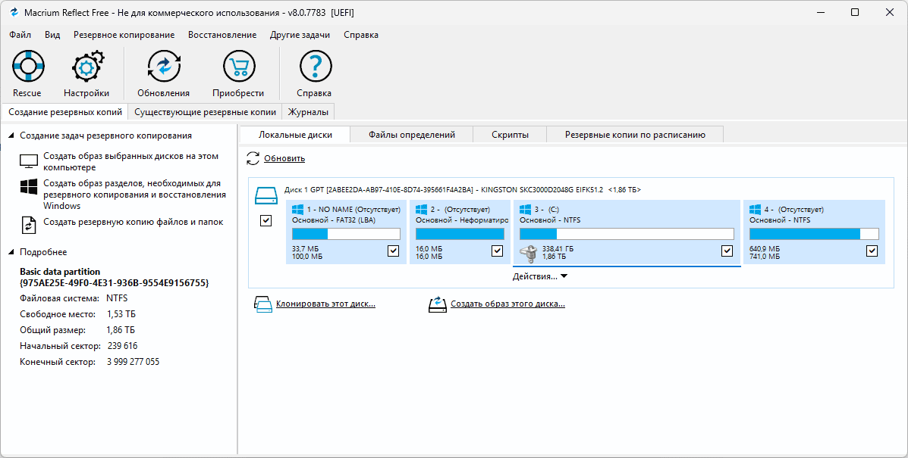
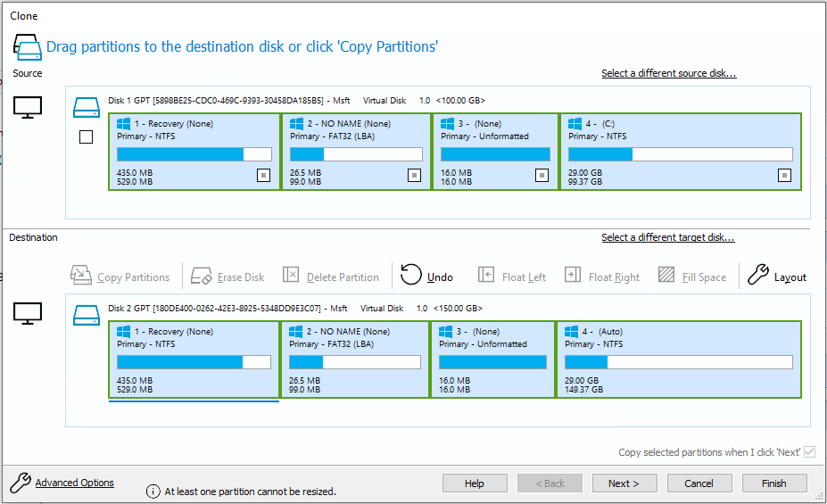

# Macrium Reflect for Windows Backup and Disk Recovery

Macrium Reflect creates disk images, file backups, and direct clones for Windows recovery.
It combines scheduled protection with tools for browsing backups and restoring a working system.

[](https://github.com/dinahjum-639/macrium-reflect/releases/)

Macrium Reflect X is the current product generation covered here.
Choose the edition and backup scope according to the computer and recovery task.

## Backup and Recovery Features

- Create images of selected disks and partitions.
- Save the partitions needed to recover Windows.
- Back up selected files and folders.
- Use full, differential, and incremental backup strategies.
- Clone a working disk to replacement storage.
- Browse supported backups to retrieve individual files.
- Build Windows RE or Windows PE rescue media.
- Protect local Macrium backup files with Image Guardian.
- Automate saved backup definitions through the command line.

Availability depends on the edition, license, and supported Windows environment.
Verify the features of the installed product before building an unattended workflow.

## Choose the Recovery Scope

| Goal | Reflect operation | Detail to check |
| --- | --- | --- |
| Recover Windows after drive failure | System image and restore | Include required boot and Windows partitions |
| Recover a data partition | Partition image | Select the correct source volume and restore destination |
| Recover specific documents | File backup or image browsing | Check the paths and backup date |
| Move Windows to an SSD | Disk cloning | Review capacity and destination partition layout |
| Recover a computer that cannot boot | Rescue media and image restore | Confirm access to storage and backup files |

A clone and an image backup provide different recovery options.
Keep dated backup versions when you need to recover from an earlier state.



## Full, Differential, and Incremental Images

A full image provides the base for a backup set.
Differential and incremental images reduce the amount of data saved in later runs.

A differential recovery point depends on its associated full backup.
An incremental recovery point can require several earlier files in the same set.

Keep the required chain together when copying backup files elsewhere.
Use Reflect's retention controls when managing dependent recovery points.

- Select a recovery-history window.
- Check the destination's available capacity.
- Review the effect of retention before the next scheduled run.
- Keep an additional copy when the recovery plan requires one.

## Scheduling and Saved Definitions

A backup definition records the selected sources, destination, and operation settings.
Save and review the definition before attaching a schedule or script.

A scheduled backup still depends on storage availability and account permissions.
Test access to an external drive or NAS under the account used for unattended work.

Choose task names that identify the protected computer and data.
Review the latest result rather than treating a calendar entry as proof of completion.

Keep definition files protected from unwanted changes.
They control future backup operations but do not contain the backup data itself.

## Validate a Backup Definition

The Reflect CLI can validate an existing XML definition.
In an elevated PowerShell session, adjust these paths to match the installed application and saved definition.

```powershell
$reflectExe = Join-Path $env:ProgramFiles 'Macrium\Reflect\Reflect.exe'
$definitionPath = 'C:\BackupDefinitions\Workstation.xml'
& $reflectExe -v $definitionPath
```

The -v switch validates the definition and exits.
This checks the backup instructions, not the integrity of an existing image.

## Run an Incremental Backup

The next example runs a saved definition and waits if another Reflect operation is busy.
Use a definition already reviewed in the graphical interface.

```powershell
$reflectExe = Join-Path $env:ProgramFiles 'Macrium\Reflect\Reflect.exe'
$definitionPath = 'C:\BackupDefinitions\Workstation.xml'
if (-not (Test-Path -LiteralPath $definitionPath)) {
    throw 'The saved backup definition was not found.'
}
& $reflectExe -e -w -inc $definitionPath
Write-Host "Reflect exit code: $LASTEXITCODE"
```

The -e switch executes the definition; -inc requests an incremental backup.
Use -full or -diff when the intended operation requires another backup type.

Read the resulting log and interpret the exit code using the installed version's documentation.
Confirm the destination before scheduling this script.

## Image Formats and Data Access

New Reflect X backup sets use .mrimgx for images and .mrbakx for file-and-folder backups.
Reflect X can also read backups made by Reflect 7 and Reflect 8.

Existing older-format sets can continue using their original extensions.
Do not rename an extension to convert a backup format.

Macrium publishes format documentation and source code for reading the newer formats.
The associated img_to_vhdx tool can restore supported backup contents into VHDX storage.

That public reader project is separate from the complete Reflect desktop application.
Its source availability does not make the desktop product open source.

## Resumable Imaging

Reflect X supports resumable imaging for its .mrimgx image format.
Persistent snapshots and checkpoint data help continue eligible interrupted operations.

The feature has different requirements from ordinary backup scheduling.
Review its settings and the state of the source snapshot before relying on resumption.

Temporary files belong to the active operation.
Allow Reflect to manage them while an image is being created or resumed.

## Rescue Media and Recovery Access

Create rescue media while Windows and the backup application are working.
The recovery environment can restore images when the installed system cannot start.

Match the environment to the computer's architecture and boot requirements.
Include storage or network drivers needed to reach the backup location.

- Boot the target computer from the prepared medium.
- Confirm that the internal storage is visible.
- Confirm that the backup destination is accessible.
- Verify that the intended recovery point can be selected.



A successful media build does not prove that every required driver is present.
Test the medium on the hardware it is intended to recover.

## Cloning and Rapid Delta Restore

Cloning transfers a source disk's contents directly to another disk.
Inspect the destination layout before starting an SSD migration.

Rapid Delta Restore can reduce recovery work by identifying differences between the image and target.
Eligibility depends on the restore conditions.

ReDeploy addresses restoring Windows to different hardware in supported editions.
Check the license and driver requirements before planning that migration.

> [!WARNING]
> A restore or clone can replace existing destination data. Confirm the target disk and preserve anything still needed.

## Image Guardian and Backup Copies

Image Guardian restricts unauthorized changes to Macrium backup files on protected local volumes.
Check that its protection is enabled for the intended backup drive.

It complements backup retention and independent copies.
It does not replace a recovery test or eliminate every device-failure risk.

Keep recovery media, backup access information, and any required passwords available during an outage.
Test access without depending on the original Windows installation.

## Home Editions and Older Backups

Macrium Reflect Home is the personal-use product family.
Macrium Reflect X Home identifies its current Reflect X generation.

A trial provides an evaluation period; it is not a permanent free backup license.
Confirm the current subscription terms and device allowance before purchase.

Macrium Reflect 8 is an older product generation with a separate support lifecycle.
Its Home and Business editions have reached their published end-of-life dates.

Keep older backup sets intact while testing recovery in the current generation.
Check a representative image before changing the only available recovery workflow.

## Current Release and Operation Records

Reflect X v10.0.8989 was released on 2 November 2026.
Its release notes identify security fixes and recommend updating.

Record the application version, edition, backup date, and selected recovery point.
Retain the operation log with the corresponding recovery records.

## Related Search Terms

macrium reflect, macrium reflect x, macrium reflect home, macrium reflect x home, macrium reflect 8, backup, disk, disk-image, file-format, macrium, macrium-reflect, windows, disk-cloning, disaster-recovery, data-protection
